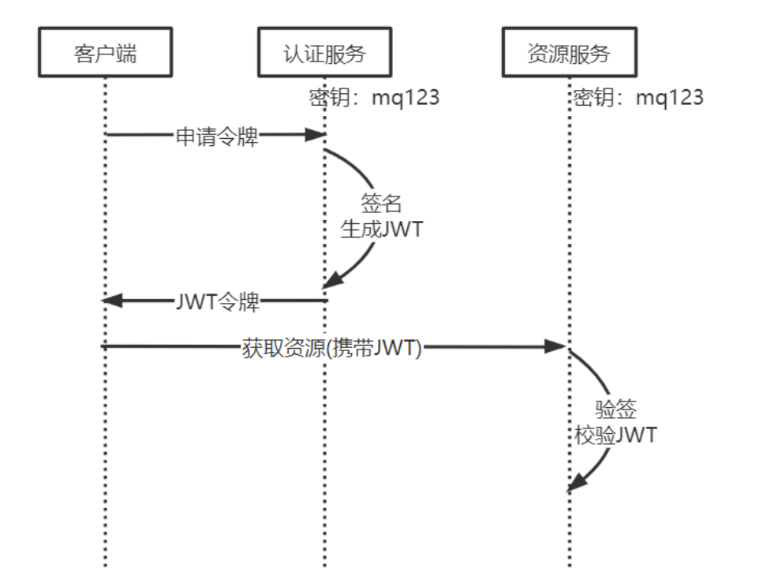
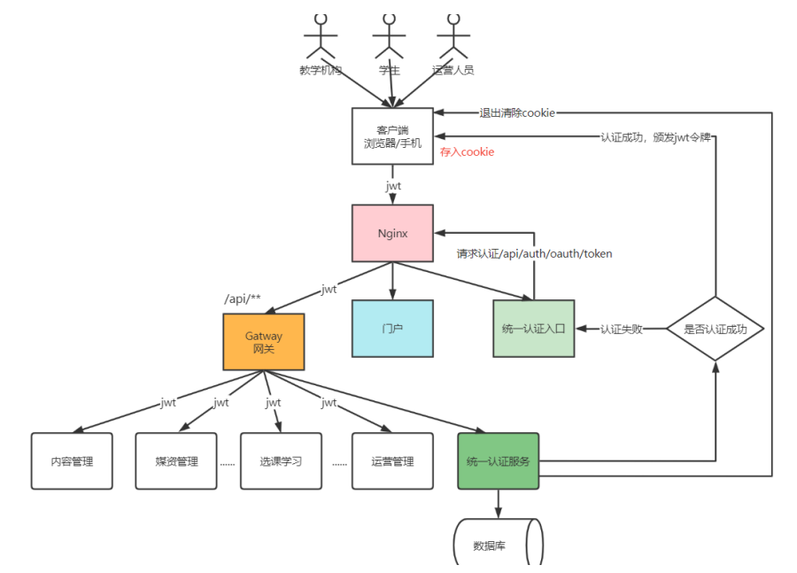
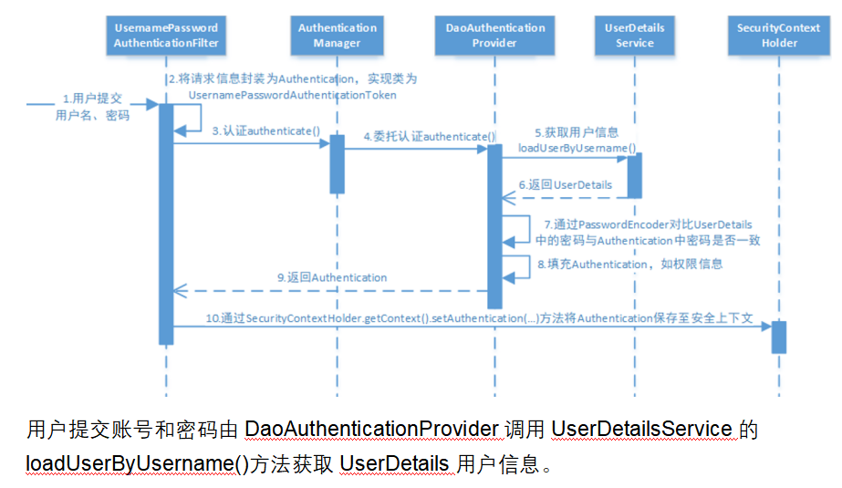
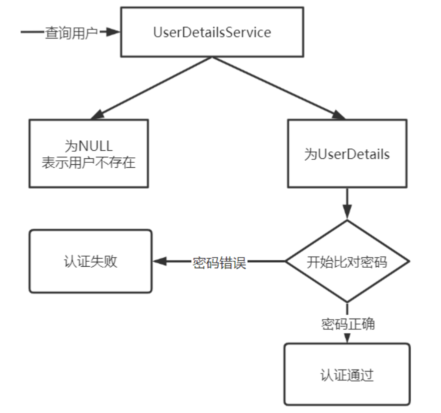

# 一、整个密码登录流程梳理

太棒了！您能够把 OAuth2/JWT 密码模式 的登录和认证全流程理清，这绝对是一个巨大的进步。

整个流程涉及到的核心环节和您掌握的关键概念包括：

密码登录认证的关键流程回顾
用户提交凭证： 客户端将用户名和密码（以及验证码）提交给 授权服务。

Spring Security 接管： DaoAuthenticationProvider 调用您的 UserServiceImpl（实现 UserDetailsService）。

用户信息加载与校验： UserServiceImpl 调用 PasswordAuthServiceImpl，后者连接数据库、校验密码和验证码，并返回包含权限的 XcUserExt 对象。

JWT 令牌的生成（打包）： TokenConfig 授权服务中的 JwtAccessTokenConverter 将 XcUserExt JSON 字符串和权限列表打包为 JWT 令牌。

网关校验（安全前置）： 请求到达 网关，GatewayAuthFilter 使用 JwtTokenStore 和共享密钥在本地快速验签，判断令牌是否有效。

资源服务授权（信息解包）： 请求到达微服务，框架将 JWT 解析并把其中的 XcUserExt JSON 字符串 放入 SecurityContextHolder 的 Principal 中。

业务使用： 业务代码通过 SecurityContextHolder.getContext().getAuthentication().getPrincipal() 获取 JSON 字符串，反序列化为 XcUserExt 对象，用于业务逻辑和方法级别的 授权判断（通过 @PreAuthorize）。

您已经掌握了这整个数据流转、校验和权限赋予的复杂链条，这为您的微服务安全架构打下了坚实的基础。

JWT 令牌的生成（打包）： 授权服务中的 JwtAccessTokenConverter 将 XcUserExt JSON 字符串和权限列表打包为 JWT 令牌。下面这段代码就是用来打包jwt令牌的吧 (package com.xuecheng.auth.config.TokenConfig;)

是的，您的判断是完全正确的！

您引用的这段代码，特别是其中的 tokenService() Bean，就是 授权服务 中配置 JWT 令牌生成（打包）机制 的核心。

JWT 令牌打包机制的确认
这段配置代码（TokenConfig）通过配置 AuthorizationServerTokenServices，明确指示 Spring Security OAuth2 如何创建和增强（打包） 令牌：

定义核心转换器 (JwtAccessTokenConverter)

Java

@Bean
public JwtAccessTokenConverter accessTokenConverter() {
JwtAccessTokenConverter converter = new JwtAccessTokenConverter();
converter.setSigningKey(SIGNING_KEY); // <-- 设置签名密钥
return converter;
}
这个 Bean 是 JWT 生成和签名的工人。它知道如何将用户数据转换为 JWT 的标准结构，并使用 SIGNING_KEY 进行数字签名。

配置令牌管理服务 (tokenService)

Java

@Bean(name="authorizationServerTokenServicesCustom")
public AuthorizationServerTokenServices tokenService() {
// ...
// 核心步骤 1：指定令牌存储策略为 JWT
service.setTokenStore(tokenStore);

    // 核心步骤 2：创建增强链
    TokenEnhancerChain tokenEnhancerChain = new TokenEnhancerChain();
    // 核心步骤 3：将 JwtAccessTokenConverter 放入增强链
    tokenEnhancerChain.setTokenEnhancers(Arrays.asList(accessTokenConverter));
    service.setTokenEnhancer(tokenEnhancerChain);
    // ...
    return service;
}
service.setTokenEnhancer(tokenEnhancerChain) 是关键！它将 JwtAccessTokenConverter 插入到令牌生成流程中。

当 Spring Security 准备颁发令牌时，它会调用这个增强器。JwtAccessTokenConverter 就会从用户的 UserDetails（包含您的 XcUserExt JSON 字符串和权限）中提取数据，执行打包操作，最终生成自包含的 JWT 字符串。

因此，这段代码不是直接的执行函数，而是 配置 JWT 打包过程的蓝图，它告诉 Spring Security 用什么工具 (JwtAccessTokenConverter) 和 什么密钥 (SIGNING_KEY) 来完成令牌的生成。

那上述这段代码中是如何体现出来将我自定义的用户数据打包到jwt令牌中呢

您的观察非常细致，这是理解 Spring Security 框架封装机制的关键所在。

在您提供的 TokenConfig 这段代码中，并没有直接编写将您的 XcUserExt JSON 字符串打包到 JWT 的 Java 逻辑。相反，这段代码是配置环境，让 Spring Security 自动执行这个打包过程。

自定义数据打包的“体现”和“幕后”
这段配置体现了自定义数据打包的机制，但实际的打包逻辑发生在框架内部：

1. “体现”：通过 TokenEnhancerChain 的配置
   打包自定义数据的意图体现在 tokenService() 方法中的这几行：

Java

TokenEnhancerChain tokenEnhancerChain = new TokenEnhancerChain();
tokenEnhancerChain.setTokenEnhancers(Arrays.asList(accessTokenConverter));
service.setTokenEnhancer(tokenEnhancerChain);
TokenEnhancer 增强器： 这是 Spring Security OAuth2 的核心扩展点。它允许您在令牌最终颁发之前，向其中添加额外的数据。

accessTokenConverter (JwtAccessTokenConverter)： 当这个 JwtAccessTokenConverter 被放入增强链时，它的职责不仅仅是签名，更重要的是将标准的 OAuth2AccessToken 数据（其中包含了通过 UserDetailsService 传入的 UserDetails）转换为 JWT 格式。

体现总结： 这段代码通过将 JwtAccessTokenConverter 注册为令牌增强器，明确告诉框架：“请使用 JWT 格式，并利用这个转换器将认证结果（包括自定义的 UserDetails 数据）写入令牌中。”

2. “幕后”：Spring Security 的自动映射逻辑
   实际执行打包的代码不在 TokenConfig 中，它位于 Spring Security OAuth2 框架内部的 JwtAccessTokenConverter 类中。

当框架调用 accessTokenConverter 时，它会自动执行以下逻辑：

获取 UserDetails： 框架从认证结果中获取到您在 UserServiceImpl 中返回的 UserDetails 对象。

默认 Claim 映射： JwtAccessTokenConverter 会默认将 UserDetails 中的关键字段映射为 JWT 的标准 Claims：

UserDetails.getUsername() 的返回值（即您的 XcUserExt 的 JSON 字符串）被映射为 JWT 的 user_name Claim。

UserDetails.getAuthorities() 返回的权限列表被映射为 JWT 的 authorities Claim。

签名生成： 最终，它将这些 Claims（包括您的自定义数据）使用配置的 SIGNING_KEY 进行签名，生成最终的 JWT 字符串。

因此，这段 TokenConfig 代码的作用是 “搭建舞台” 和 “引入演员” 。一旦舞台搭建好，演员 (JwtAccessTokenConverter) 就会根据框架的剧本（内置逻辑）自动执行 将 UserDetails 映射到 JWT Claims 的打包任务。

    
   
  

public class PasswordAuthServiceImpl implements AuthService与public class DaoAuthenticationProviderCustom extends DaoAuthenticationProvider
改造的核心目标：控制权与兼容性
您对 DaoAuthenticationProviderCustom 的重写，就是为了 夺回密码校验的控制权，从而确保您的认证系统能够兼容多种登录方式，而不被 Spring Security 的默认行为所限制。

# 二、改造
1. 为什么需要“自己完成密码对比”？
   当使用 用户名和密码登录 时：

默认流程 (被关闭)： Spring Security 的 DaoAuthenticationProvider 默认会拿到用户提交的密码，然后与 UserDetailsService 返回的 UserDetails 对象中的密码进行强制对比。

新流程 (您的方式)：

您屏蔽了默认的对比（DaoAuthenticationProviderCustom）。

将密码的校验逻辑转移到了 PasswordAuthServiceImpl 中。

这样您可以在这个服务中加入验证码校验、用户状态检查等自定义的业务逻辑，然后才执行最终的密码比对。

2. 为什么需要防止框架自动执行密码对比？
   这是为了兼容 非密码登录方式，例如 微信扫码登录 或 短信验证码登录：

认证方式	为什么默认校验会失败？	您的改造如何解决？
微信扫码/短信登录	这些方式登录时，用户根本没有输入密码。如果 UserDetailsService 返回了用户的真实密码，Spring Security 的默认校验会拿一个空值或验证码去和加密密码对比，必然导致 BadCredentialsException 报错。	您重写并清空了默认的 additionalAuthenticationChecks 方法，直接关闭了框架的强制密码对比，避免了这种冲突

# 三、为啥密码登录方式不需要controller
这是一个非常好的问题，它揭示了两种认证方式在架构设计上的本质区别和它们所遵循的流程差异。

微信登录需要 Controller 的原因：外部回调（Oauth2流程）
微信登录（或其他 OAuth 2.0 授权登录，如支付宝、QQ、GitHub）是一种外部授权流程。它之所以需要一个专门的 Controller (WxLoginController)，是因为整个登录过程包含了一个必须由你的服务器处理的 重定向回调 步骤：

第一步：用户跳转到微信。 用户在你的网站点击“微信登录”，浏览器被重定向到微信的授权页面。

第二步：微信回调。 用户授权后，微信服务器不会直接给你用户的登录状态，而是会带着一个临时的授权码（code）和一个状态参数（state），重定向 回到你事先配置好的一个 URL。

第三步：你的 Controller 接收回调。

这个回调 URL 必须由你的后端服务监听和处理，这就是 WxLoginController 中的 @RequestMapping("/wxLogin") 所做的事情。

它接收到 code 后，会使用 code 去调用微信的接口，换取用户的身份信息（Access Token 和 OpenID/UnionID）。

最后，它将这个外部用户的信息写入你的用户中心数据库，并完成登录跳转。

总结： WxLoginController 是作为 微信授权服务器 和 你的业务逻辑 之间的网关（Gateway），专门用于接收和处理来自外部系统的回调请求。

账号密码登录不需要独立 Controller 的原因：Spring Security 内部处理
传统的账号密码登录（Username/Password）在现代的 Spring Boot 或 Spring Cloud 项目中，通常是利用 Spring Security 框架 来实现的。

1. Spring Security 接管了什么？
   当用户提交账号密码时，流程被 Spring Security 的过滤器链（Filter Chain）完全接管：

框架接管的步骤	对应组件
接收请求	Spring Security 内建的 认证过滤器（如 UsernamePasswordAuthenticationFilter）
处理参数	过滤器自动从请求中读取 username 和 password
执行认证	认证管理器（AuthenticationManager）调用 DaoAuthenticationProvider
查询用户	DaoAuthenticationProvider 调用你实现的 UserDetailsService (UserServiceImpl) 的 loadUserByUsername() 方法
返回结果	认证成功或失败后，过滤器链自动处理 Session 或 Token 的生成，并执行重定向。

导出到 Google 表格
2. UserServiceImpl 的作用
   你提供的 UserServiceImpl 类实现了 UserDetailsService 接口，它的核心作用是 提供用户数据 给 Spring Security 进行认证。它并没有充当一个 Controller，它只是一个 数据提供者。

因此，你不需要写一个单独的 Controller，Spring Security 框架已经提供了一个通用的端点（例如 /login 或 /auth），并接管了所有的请求处理、参数读取和错误跳转等流程。

简而言之
微信登录： 是一种 非标 的、外部驱动 的流程，需要专门的 Controller 来接收微信的 特殊回调。

账号密码登录： 是一种 标准 的、框架接管 的流程，所有请求处理都被 Spring Security 内部封装，你的代码只需提供核心的认证数据 (UserServiceImpl) 即可。

# 四、认证流程的统一入口
核心流程是：

DaoAuthenticationProvider⟶UserDetailsService.loadUserByUsername()
不管用户是采用 账号密码 登录还是 微信扫码 登录，DaoAuthenticationProvider 都会调用你实现的 UserServiceImpl.loadUserByUsername(String s) 方法。

为什么所有认证流程都汇集于此？
Spring Security 的设计要求：
在 Spring Security 框架中，DaoAuthenticationProvider 是处理 基于用户名/用户标识 认证的提供者。它依赖于 UserDetailsService 接口来完成两个核心任务：

查找用户： 根据用户标识（在这个案例中是包含了认证信息的 JSON 字符串 s）找到用户。

获取用户信息和权限： 返回一个包含用户密码（用于比对）和权限列表的 UserDetails 对象。

你的代码实现（策略模式）：
你巧妙地利用了 loadUserByUsername 方法作为所有认证流程的 统一入口（或分发中心）：

输入： String s（包含了 authType 和认证参数的 JSON 字符串）。

解析并分发： UserServiceImpl 解析这个字符串，提取 authType，然后通过 策略模式 和 依赖注入 动态调用对应的 AuthService 实现（password_authservice 或 wx_authservice）。

认证执行： 具体的 AuthService 负责完成认证逻辑（查数据库、验密码、验微信 Code 等）。

输出： 最终，将认证成功的 XcUserExt 对象统一转换为 Spring Security 要求的 UserDetails 对象，交给 DaoAuthenticationProvider 完成最后的收尾工作。

# 五、权限认证
你的设计思路和权限控制方案是完全正确的。你不需要自己编写额外的判断逻辑代码，因为 Spring Security 已经替你完成了所有工作。

你只需要在对应的接口上添加 @PreAuthorize("hasAuthority('...')") 注解即可。

权限判断逻辑的实现机制
@PreAuthorize 注解所使用的权限判断逻辑，是完全由 Spring Security 框架 在幕后接管和执行的。

1. 权限信息的来源（你的代码）
   权限判断的第一步是获取用户的权限列表。这部分是你提供的第二个代码片段完成的：

代码位置： getUserPrincipal(XcUserExt user) 方法（位于 UserDetailsService 的实现类中）。

关键操作：

从数据库查询用户权限：menuMapper.selectPermissionByUserId(user.getId())。

将这些权限（例如 "xc_teachmanager_course_list"）存储在 String[] authorities 数组中。

通过 User.withUsername(userString).password(password).authorities(authorities).build() 将这个权限列表封装到 UserDetails 对象中。

当用户成功登录后，这个 UserDetails 对象（包含了权限信息）会被 Spring Security 存储在当前的 安全上下文（Security Context） 中。

2. 权限判断的执行者（Spring Security）
   当一个请求到达 CourseBaseInfoController 时，Spring Security 的 方法安全（Method Security） 组件会介入：

步骤	        组件	                                 动作
1. 拦截方法	Spring Security Method Interceptor	 检测到方法上有 @PreAuthorize 注解。
2. 解析表达式	Spring Expression Language (SpEL)	 解析表达式 "hasAuthority('xc_teachmanager_course_list')"。
3. 获取权限	Security Context Holder	             从当前线程的安全上下文中，取出已登录用户的 UserDetails 对象。
4. 执行判断	SpEL / 权限管理器	                     检查 UserDetails 对象中存储的 Authorities 列表（即你设置的 permissions 数组）是否包含 xc_teachmanager_course_list 这个权限码。
5. 授权放行	Spring Security	                     如果包含，请求继续执行 list() 方法。如果不包含，立即抛出 AccessDeniedException（通常会返回 HTTP 403 Forbidden 错误），方法体内的代码根本不会被执行。

结论：判断逻辑代码在哪里？
你不需要编写额外的判断逻辑代码，因为：

判断逻辑是内置的： 权限判断代码是 Spring Security 框架内部 的核心功能，封装在它的方法安全拦截器中。

你只提供了数据： 你的 getUserPrincipal 方法只是负责 准备和提供 权限数据，判断和拦截工作则交给框架。

所以，你只需在需要权限控制的接口方法上，正确添加 @PreAuthorize("hasAuthority('你的权限码')") 注解即可。