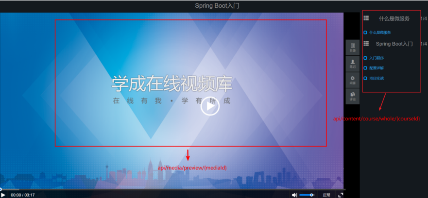
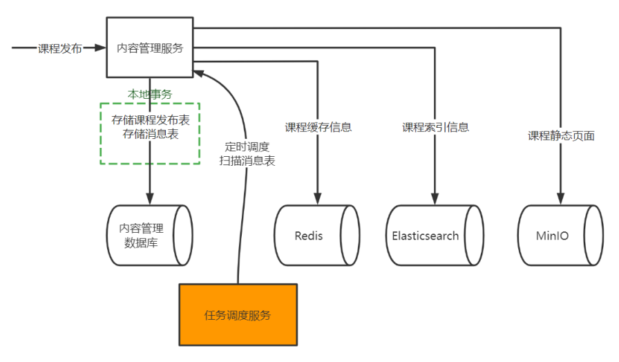

# 第四章课程发布
## 一、课程预览
public ModelAndView preview(@PathVariable("courseId") Long courseId)通过这个类使用Freemarker模板引擎进行实现
下图是课程预览的效果图，也是课程正式发布后的课程详情界面

课程预览返回的数据包括：课程基本信息，课程营销信息，课程计划，课程师资表
从课程详情页面点击右上角视频进入视频播放页面，如下图

所以还需要这两接口：public CoursePreviewDto getPreViewInfo(@PathVariable("courseId") Long courseId) 返回值是课程基本信息，课程营销信息，课程计划。public RestResponse<String> getPlayUrlByMediaId(@PathVariable String mediaId)返回的是视频的播放地址。

课程预览接口告一段落了，接下来就是课程发布了
## 二、课程发布

### 2.1 提交课程审核

### 2.2 课程发布

课程发布完成之后将课程发布信息存储到数据库中同时存储消息表，选用任务调度方案去实现分布式事务控制，课程发布满足AP即可

消息表有自己的Service接口和实现类是在xuecheng-plus-message-sdk中，其中有向消息表中添加记录，还有扫描消息表等方法。

然后定义一个MessageProcessAbstract抽象类，他是任务调度和消息处理的骨架。它的职责是处理通用的、与业务无关的流程。

然后创建coursePublishJobHandler开始使用xxl-job分布式任务调度框架进行课程发布任务调度，任务调度是从coursePublishJobHandler这个类调用了MessageProcessAbstract抽象类中的process方法定义任务的通用框架和流程。然后抽象类中的process方法调用execute抽象方法 然后在CoursePublishTask中找到具体实现
开始执行任务：生成课程静态页面并上传到minio中，这个方法的主体逻辑是在CoursePublishServiceImpl类中定义的通过openfeign远程调用媒资服务中的接口上传图片的方法,上传静态页面到minio中需要改造上传图片的方法，添加一个参数即可。
然后执行向Elasticsearch中写数据方法，这个需要用到另一个微服务xuecheng-plus-search，通过openfeign进行远程调用。这个微服务中定义了CourseIndexService接口和实现类CourseIndexServiceImpl，这个类中定义了向Elasticsearch中写数据的方法。
CourseSearchController这个方法实现了将 用户的搜索意图 翻译成 Elasticsearch 能够理解的查询语言 (DSL)，然后将 ES 的底层结果 转换为 应用层可用的业务数据结构 的整个过程。 它是你的课程系统能够提供高性能（比如聚合）、高质量搜索体验（高亮设置）的基石。
